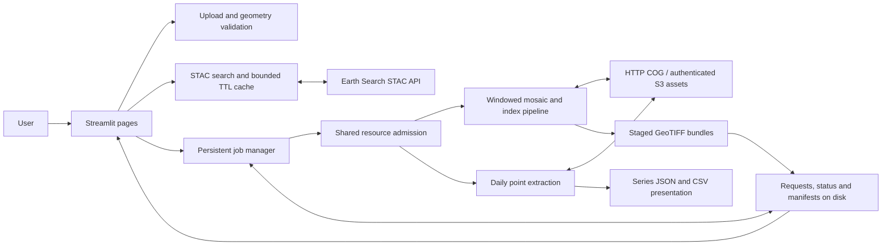
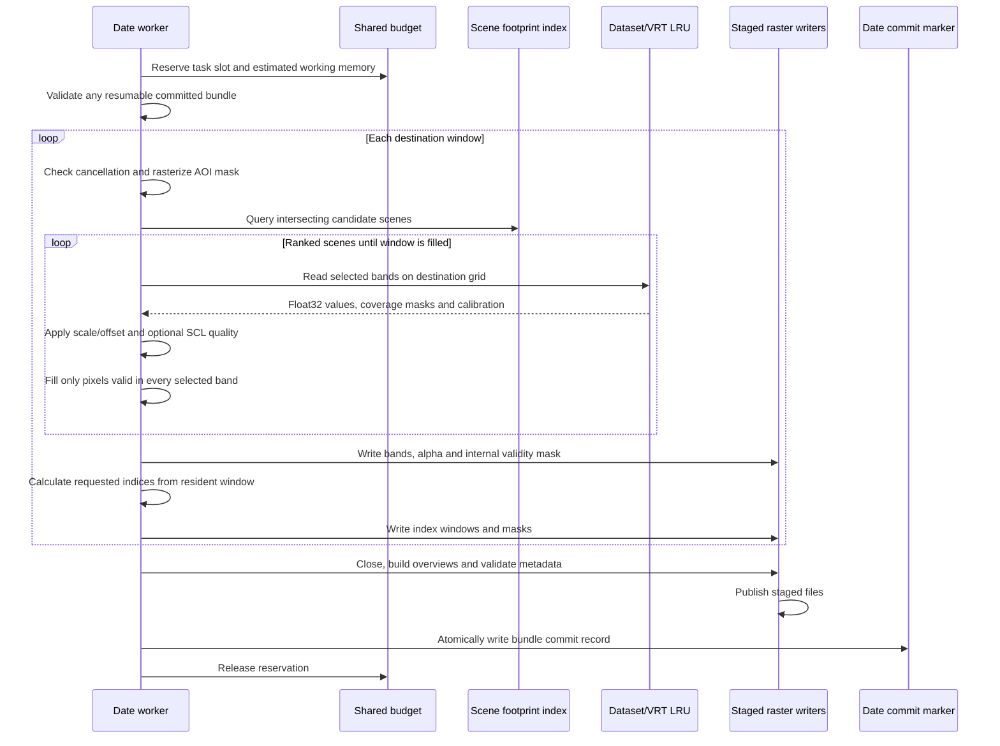
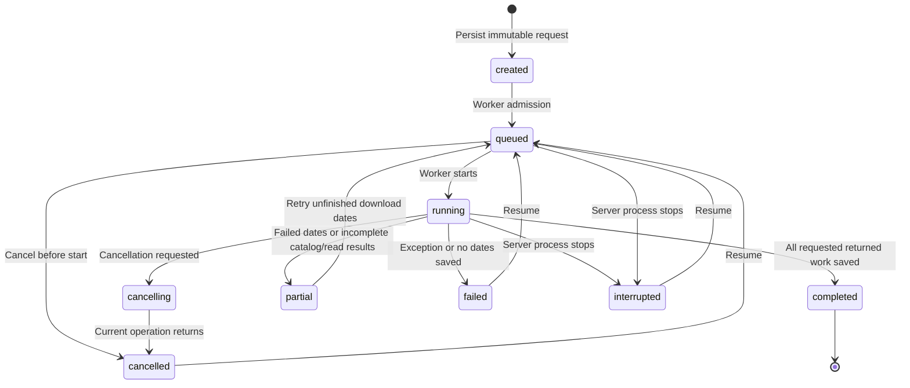
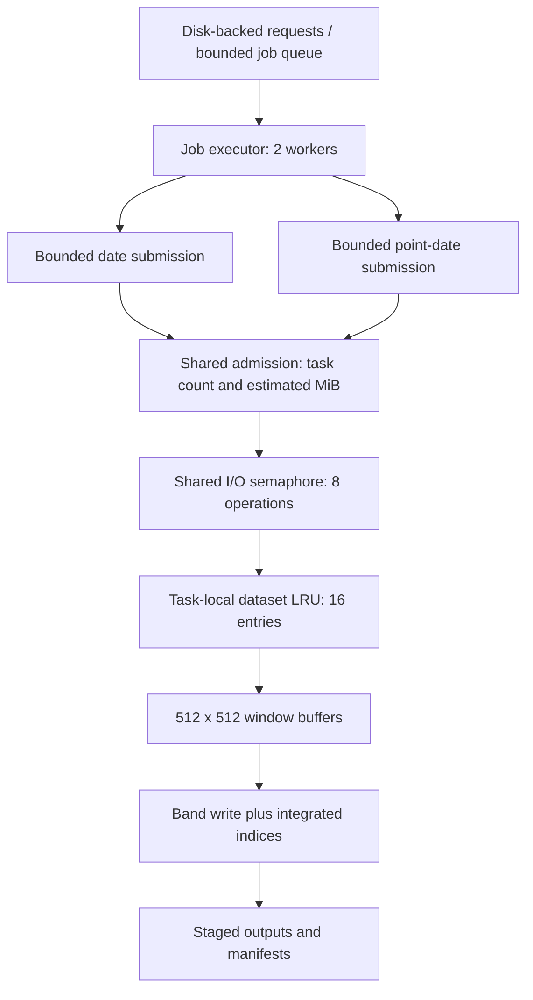

# Satellite Data Downloader — technical architecture

Version 2.0 · 14 November 2026 · implementation and verification report

## 1. System purpose and resulting design

The application searches Element 84 Earth Search (Collection 1 Sentinel-2 is the UI default), creates polygon-clipped daily satellite mosaics, calculates spectral indices, and extracts daily NDVI/NDWI observations at a point. Streamlit provides the interface; processing runs in background threads with local JSON state and GeoTIFF artifacts.

The earlier implementation materialized complete band mosaics and copies for every active date. The current implementation streams fixed-size windows through a shared destination grid, normalizes each source according to its metadata, chooses coherent scene pixels, and writes bands and indices together. Point extraction evaluates same-day alternatives rather than discarding them before quality checks.

This is a **single-process application for a local or trusted deployment**. The resource limits coordinate all sessions within that process. They are not distributed quotas. Job receipts allow recovery across browser sessions and server restarts; receipts are capabilities and should be kept private.



## 2. Components and boundaries

| Component | Responsibility | Boundary |
|---|---|---|
| `app.py`, `portal.py`, `pages/` | ASGI entry point, home page, search controls, map and job submission | Raster workers report state without calling Streamlit |
| `results_ui.py`, `result_artifacts.py`, `artifact_delivery.py` | Full-width dashboard, bounded thumbnails, committed-file TIFF/ZIP streaming | Expiring capabilities expose only committed outputs |
| `result_metrics.py`, `job_progress.py` | Online pixel summaries and structured progress aggregation | Bounded sample storage; thread-safe progress snapshots |
| `ui_components.py` | Cached upload parsing, job polling, cancellation/recovery controls, result presentation | Workers receive ordinary Python callbacks |
| `input_utils.py` | Upload byte limits, archive validation, CRS normalization, single-point/polygon validation | Temporary ZIP files are removed after parsing; archives are not extracted |
| `satellite_config.py` | Collection-specific bands, native resolutions, index formulas, required-band expansion | One shared capability registry for UI and processing |
| `stac_utils.py` | Search validation, per-thread client, retries/timeouts, pagination, completeness, TTL cache | Only successful catalog responses are cached |
| `jobs.py` | Immutable request snapshots, bounded job queue, status, cancellation, receipt recovery | Job state is local; no distributed broker or authentication layer |
| `processing_utils.py` | Date orchestration, reporting, coherent mosaics, point selection, standalone indices | Preserves original tuple return shapes while adding keyword-only options |
| `raster_engine.py` | Grid selection, radiometry, VRT reprojection, source LRU, windows, staged rasters | Dataset handles remain task-local; arrays remain window-sized |
| `resource_budget.py` | Process-wide task, estimated memory and I/O admission | Estimates working memory rather than enforcing an OS RSS limit |
| `persistence.py` | Atomic JSON replacement, temporary artifact cleanup, directory locks | POSIX filesystem locking; macOS/Linux supported |

## 3. Catalog discovery and input handling

1. Validate dates, collection, cloud threshold, and WGS84 geometry or bounding box.
2. Use an exact `intersects` geometry when supplied. Point searches use the point itself rather than an artificial surrounding box.
3. Search pages with a 100-item page-size hint. The public API defaults to exhausting pagination. The UI provides an explicit configurable scene limit, initially 1,000.
4. A limited search requests one extra item to detect truncation. The UI displays incomplete results and includes completeness in saved jobs.
5. Apply an inclusive cloud threshold (`lte`). A 100% threshold omits the cloud predicate, including scenes without that metadata.
6. Cache successful item snapshots for 300 seconds, with both a 32-entry limit and a 32 MiB serialized-byte limit. Return independent reconstructed items so callers cannot mutate cached records.

Clients are thread-local and reuse their HTTP sessions. Requests have a 10-second connection timeout and 45-second read timeout, three transient retries for 429/500/502/503/504, capped backoff and capped `Retry-After` waits. These are per-request controls, not a guaranteed end-to-end job deadline.

A search fingerprint includes dates, collection, cloud limit, geometry/bbox and result limit. Changes invalidate the processing action. Band/index/resolution controls do not require another catalog search; their processing request is snapshotted separately.

Uploads are limited to 20 MiB. ZIP metadata is checked against 100 MiB total uncompressed size and must identify exactly one shapefile. A shapefile without a CRS is rejected. GeoJSON defaults to WGS84 as specified by the format. Invalid, empty, nonfinite or inappropriate geometry types are rejected. Polygon holes are retained. The point workflow requires exactly one Point.

AOIs spanning more than 180 degrees of longitude must be split before submission. Exact poles are excluded from polygon processing. Geometry complexity is limited to 200,000 coordinates.

## 4. Raster data flow and scientific semantics

### Destination grid

A run uses one grid for every date and band. By default it selects the AOI centroid's UTM zone, with EPSG:3413/3031 for polar regions. Callers can provide another projected CRS in metres. Bounds are snapped outward to the chosen resolution. This supports sources in different UTM zones without passing mismatched CRSs to `rasterio.merge`.

The UI offers 10, 20, 60 metres and **coarsest selected native resolution**. The native option chooses the largest nominal band resolution in the selection; it does not create separate grids per band. A 20/60 m source resampled to 10 m gains pixels, not new spatial detail. Sentinel-1 uses a nominal 10 m option; original GRD amplitude data is not terrain-corrected by this application.

A 250-million-pixel default guard rejects oversized grids. Disk admission estimates uncompressed outputs, adds a 40% staging/overview allowance and retains 20% free-space headroom. Per-date checks also protect retries of corrupt outputs.

### Window pipeline

Default windows are 512 × 512 pixels. A spatial index filters distant scene footprints before asset opens. Unknown footprints are retained conservatively. The LRU keeps a bounded number of open datasets/VRTs within a task.



For each pixel, all selected spectral bands come from the **same scene**. Candidates are ranked by scene cloud cover, acquisition time, scene ID and asset URLs. A scene with incomplete selected assets cannot supply an incoherent partial spectrum. Gaps remain nodata if no complete candidate covers the pixel.

Continuous bands use bilinear reprojection through `WarpedVRT`, with a floating-point working type. SCL and alpha masks use nearest-neighbour resampling. GCP-only georeferencing is supported through GDAL's warp machinery. Source nodata and internal masks are respected before normalization.

### Radiometry

Normalization uses metadata, never observed value magnitudes. The UI defaults to `sentinel-2-c1-l2a`. The legacy `sentinel-2-l2a` COG archive has confirmed inconsistent offset metadata, including disagreement with its own harmonization flag. Strict mode rejects a nonzero offset from that known legacy COG source; it does not guess a correction. This distinction was exposed by a real raster read and is consistent with the provider's open [offset inconsistency issue](https://github.com/Element84/earth-search/issues/71).

For legacy analysis, an explicit `radiometry_policy="metadata"` accepts the declared correction, while `"harmonized"` uses the declared scale with zero offset. Such overrides require the operator to know the source convention; policy and calibration origins are recorded in provenance. The default `"strict"` follows metadata for Collection 1 and other unambiguous sources.

Calibration precedence:

| Priority | Rule |
|---|---|
| Already-normalized output | Reflectance tags mean scale 1, offset 0; do not apply corrections twice |
| Asset metadata | Use declared STAC `raster:bands` scale and offset, subject to the strict legacy-source guard |
| Explicit legacy policy | `metadata` accepts the declared correction; `harmonized` uses zero offset and records the override |
| Raster metadata | Use nonidentity GeoTIFF scale and offset |
| Explicit legacy input | `calculate_indices(..., legacy_scale=...)` declares units for old files |
| Sentinel-2 integer fallback | Use scale 0.0001, offset 0 when calibration metadata is absent; record this fallback in provenance |
| Other data | Identity for non-optical amplitude/categorical data; unknown legacy float composites require explicit units |

The offset is applied separately to each scene before its values enter the mosaic. A common multiplicative scale can cancel in a normalized difference; a nonzero offset generally does not. EVI and SAVI also require reflectance inputs because their formulas contain additive constants.

The application cannot independently repair unknown catalog metadata errors or infer undocumented harmonization from pixels. Known ambiguous legacy-source offsets fail closed by default; other upstream metadata remains authoritative. For important historical analyses, inspect the recorded calibration origins and provider conventions.

### Output format

- Sentinel-2 bands: physical reflectance, Float32, scale 1/offset 0, explicit units tags.
- Sentinel-1 bands: amplitude values, explicitly labelled amplitude; no SAR radiometric calibration, speckle filtering or terrain correction is implied.
- Indices: dimensionless Float32. Exact zero denominators and nonfinite results become nodata.
- Nodata: `-99999.0`, plus an internal 0/255 validity mask. Zero reflectance remains valid.
- Composite's last band: compatibility `alpha` band, 0/1.
- GeoTIFFs: tiled 256 × 256 blocks, band interleave, LZW compression, floating-point predictor, BigTIFF when safer, and reduced-resolution overviews when large enough.
- Outputs are tiled GeoTIFFs with overviews. They are **not advertised as formally validated COG-layout files**.

Integrated index computation avoids rereading composites. Standalone `calculate_indices` remains available and aligns inputs by full CRS/transform/grid, even when equally shaped inputs cover different places. Each input's alpha mask retains its original georeferencing.

## 5. Point timeseries selection

Point extraction groups candidates by date but retains every candidate until quality checks have run. It filters exact item footprints, orders candidates deterministically, and tries alternatives when a preferred scene is cloudy, missing an asset, outside the pixel grid or unreadable.

Each asset opens once per candidate; there is no extra CRS-only open. Each band's point coordinate is transformed using that band's own CRS. Masked samples, either band's nodata and nonfinite values are rejected. Calibration is applied before arithmetic on Python floats.

When SCL filtering is requested, missing SCL fails closed and is recorded in diagnostics. Rejected SCL classes are 0, 1, 3, 8, 9 and 10. Snow/ice class 11 is not classified as cloud by this policy. Scene-wide cloud cover ranks candidates; it does not replace per-pixel SCL quality.

The result is one observation per UTC acquisition date, sorted ascending. Diagnostics record attempted scene IDs, rejection/read-error reasons, selected scene, read-failure count and search completeness. Cloudy gaps are not automatically interpolated. UI settings are snapshotted, so displayed results identify the original point/index/period even after controls change.

## 6. Job lifecycle, cancellation and recovery



The executor defaults to two job workers and allows at most 16 active/queued job records. Queued requests live on disk rather than being retained as large future arguments. Completed registry entries are pruned on new submissions.

A cancellation event is checked between windows, candidates and resource waits. A network call or GDAL overview build already in progress must return before cancellation takes effect. Cancellation does not forcibly terminate native code.

Recovery is explicit through a downloaded receipt or the CLI. Download resume validates each date's fingerprint, file existence and block readability. Complete date bundles are reused; failed, missing or corrupt bundles are regenerated. Point jobs rerun their extraction rather than maintaining a per-pixel checkpoint. Jobs interrupted by a process restart are marked interrupted when recovered; they do not restart automatically.

A truncated catalog snapshot cannot be expanded by resuming the same immutable job. Increase the search limit or narrow the query and create a new job.

### Publication and filesystem layout

```text
output_data/
  <owner UUID>/
    <job UUID>/
      request.json                 immutable UI/API request snapshot
      job.json                     current status/progress/result
      processing-config.json       immutable raster configuration and source signatures
      manifest.json                aggregate committed-date report
      .processing.lock             output directory lock
      .dates/
        2025-04-01.json             commit record for one complete bundle
      2025-04-01_10m_all_bands.tif
      2025-04-01_NDVI.tif
      series.json                  point-job result, instead of raster artifacts
```

UUIDs prevent same-second collisions and separate session output directories. Only explicit committed output lists feed subsequent processing. There is no scan of arbitrary TIFFs in a folder.

Raster bundles write into hidden temporary directories on the same filesystem. Writers close successfully before files are renamed. The date marker commits the **whole bundle**. A crash between file renames can leave an uncommitted subset of final TIFFs; absence of a matching valid date marker prevents those files from being accepted as a complete result. Stale staging directories are removed after acquiring the exclusive output lock during recovery. JSON updates use temporary files and atomic replacement. Filesystem and power-loss guarantees still depend on the host filesystem.

## 7. Resource controls and performance



Nested band executors have been removed. All sessions share task admission and I/O slots. The date-worker count is the minimum of the configured cap, global task cap and available estimated memory capacity.

The task estimate in MiB is:

```text
ceil(window_size² × (12 × selected_band_count + 64) / 2²⁰
     + source_cache_entries × warp_memory_MiB + 32)
```

At the defaults, an eight-band task reserves approximately 200 MiB. A 512 MiB budget admits at most two such date tasks concurrently. This controls window/VRT working sets; Python imports, catalog metadata, GDAL's global block cache, allocator retention and other native allocations are additional. The setting is not an OS-enforced total-memory ceiling.

| Setting | Default | Purpose |
|---|---:|---|
| `SATELLITE_MEMORY_MB` | 512 | Estimated shared working-memory admission budget |
| `SATELLITE_GLOBAL_TASKS` | 4 | Shared active raster/point task limit |
| `SATELLITE_DATE_WORKERS` | 4 | Per-run date-worker upper bound |
| `SATELLITE_TIMESERIES_WORKERS` | 8 | Per-run point-date upper bound, also limited globally |
| `SATELLITE_IO_WORKERS` | 8 | Shared active open/read operations |
| `SATELLITE_WINDOW_SIZE` | 512 | Window side length, capped at 2048 |
| `SATELLITE_SOURCE_CACHE` | 16 | Dataset/VRT LRU entries per task, capped at 64 |
| `SATELLITE_WARP_MEMORY_MB` | 8 | Warp-memory setting per VRT |
| `SATELLITE_GDAL_CACHE_MB` | 64 | GDAL block cache setting |
| `SATELLITE_JOB_WORKERS` | 2 | Background job executor workers |
| `SATELLITE_MAX_QUEUED_JOBS` | 16 | Active plus queued job registry admission |
| `SATELLITE_MAX_PIXELS` | 250000000 | Per-grid pixel guard |

Set these before starting the process; most resource constants initialize at import. The old `SATELLITE_BAND_WORKERS` tuning is obsolete. Its public compatibility constant is now 1.

Local source file sizes and modification times participate in request fingerprints; changed local inputs cannot silently reuse older outputs. Remote assets are assumed immutable under their catalog identity. Full per-date calibration records identify their asset URL and band index.

The immutable processing configuration is stored once; aggregate progress manifests do not repeatedly embed all STAC metadata. Source calibration metadata is cached within each task. Window arrays are normalized in place, and no full-AOI `np.stack` is retained.

### Measured local benchmark

See [benchmark_results.json](benchmark_results.json) for raw results, environment, source hash and methodology. The benchmark compares the original source snapshot against the new pipeline in isolated child processes, with identical synthetic local COGs, eight bands, three indices, one worker, a 64 MiB GDAL cache and overview generation disabled. Fixture generation, imports and catalog/network access are outside the elapsed-time measurement; peak RSS includes imports. These are pipeline-only child processes: the new core avoids importing GeoPandas, while the full UI still imports it for uploads; absolute server RSS will differ.

Historical core measurements in the clean locked environment (before online result summaries; see [current measurements](ux_benchmark_results.json) for this revision):

| Grid | Original time | Windowed time | Original peak RSS | Windowed peak RSS |
|---|---:|---:|---:|---:|
| 1024 × 1024 | 0.777 s | 0.622 s | 278.48 MiB | 182.06 MiB |
| 2048 × 2048 | 3.958 s | 2.486 s | 666.27 MiB | 192.02 MiB |

At the larger grid, peak RSS decreased approximately 71% and elapsed time approximately 37%. A fourfold pixel increase added only about 10 MiB to windowed peak RSS, versus about 388 MiB to the original. Sampled NDVI/EVI/SAVI values agreed to Float32 precision.

The windowed TIFF bundle was approximately 33% larger in this random-data fixture. Physical reflectance Float32 values have different compression behaviour from integer-valued DN floats, and layout/mask choices also differ. Overviews add further storage and CPU work when enabled. These tests establish local memory/I/O behaviour; they do not establish cloud throughput, multi-user tail latency or a universal speedup.

## 8. Public APIs and compatibility

```python
process_items(items, aoi_geom, collection="sentinel-2-l2a", bands=None,
              out_dir="downloads", progress_callback=None, return_report=False,
              *, indices=None, resolution=10, target_crs=None,
              cancel_event=None, resume=True, apply_scl_filter=False,
              requester_pays=False, detail_callback=None, overviews=True,
              radiometry_policy="strict", event_callback=None)
# Existing: (composite_paths, elapsed_seconds)
# With return_report=True: (..., report), including integrated index paths.

extract_pixel_timeseries(items, point_geom, index="NDVI",
                         apply_scl_filter=False, progress_callback=None,
                         *, return_report=False, cancel_event=None,
                         radiometry_policy="strict")
# Existing: (observations, elapsed_seconds); optional third diagnostics result.

search_stac(bbox, start_date, end_date, collection, max_cloud_cover=100,
            *, max_items=None, return_report=False, intersects=None,
            use_cache=True, cancel_event=None)
# Existing list result; optional SearchResult carries completeness and cache metadata.

calculate_indices(file_paths, indices, out_dir,
                  *, legacy_scale=None, cancel_event=None)
# Explicit input files; unknown legacy float units require legacy_scale.
```

The API's original `collection="sentinel-2-l2a"` default is retained for compatibility; explicitly pass `collection="sentinel-2-c1-l2a"` when processing Collection 1 search results. Collection 1 may have different historical coverage, so the legacy source remains available with explicit calibration decisions.

Intentional behaviour changes: the UI defaults to Collection 1 and rejects ambiguous legacy COG offsets in strict mode; Sentinel-2 exports contain reflectance rather than unlabeled DN floats; default API bands are RGB rather than an impossible optical/radar combination; missing requested SCL excludes observations; same-day selection is deterministic and quality-aware; unknown/missing index bands produce actionable validation errors; output directories cannot mix different requests.

The standalone legacy-float migration choices are `legacy_scale=0.0001` for old DN composites or `legacy_scale=1` for known reflectance. A legacy file without offset provenance cannot have its historical offset reconstructed reliably; regenerate from catalog assets for rigorous analysis.

## 9. Verification and review closure

[Machine-readable validation evidence](validation_results.json) records the exact environment and check results.

The initial core revision passed **85 offline unittest cases** in the clean locked Python 3.14.9 environment. The subsequent results dashboard/export revision passes **113 offline cases**; see [UX implementation and diagrams](UX_IMPROVEMENTS.md) and [current evidence](ux_validation_results.json). Ruff and `git diff --check` pass. Python 3.12 validation is configured in CI but was not executed locally.

The offline suite covers arithmetic overflow, reflectance offsets, per-scene calibration, cross-CRS and GCP warping, polygon holes, native resolution, nodata/internal masks, coherent multiband scene selection, complete/limited searches, inclusive clouds, cache isolation/limits/expiry, HTTP timeout configuration, stale UI state, missing assets/SCL, all seven known index formulas, shifted and cross-resolution masks, staged write failures, corrupt bundle recovery, cancellation, resource admission, job persistence and receipt path isolation.

Streamlit AppTest verifies page startup, completed-job report rendering, and processing invalidation after a collection change. The local Streamlit health endpoint responds successfully. Browser-host access was unavailable during this session, so map appearance and browser interactions were not visually verified. The explicit [public live smoke test](../scripts/smoke_catalog.py) searched a London city-centre fixture, read actual Collection 1 COG pixels, generated an 8 × 12 composite/index grid and independently verified NDVI = 0.6043885124233624 from raw NIR 3486/red 1613 with scale 0.0001 and offset -0.1. [Raw live evidence](live_smoke_results.json) records the scene, limits and calibration. This is a calibration-path smoke test, not a claim of complete temporal coverage or cross-provider scientific validation.

Live authenticated Sentinel-1 raster reads were not exercised; local amplitude/GCP cases and access-preflight behaviour are covered.

| Original finding | Implemented resolution |
|---|---|
| Unsigned timeseries overflow | Float conversion and calibrated floating-point arithmetic |
| Negative fill into unsigned mosaic | Float32 VRT/window buffers with explicit masks |
| Ignored offsets/guessed scaling | Per-source normalization, units, Collection 1 default, strict legacy guard and explicit override provenance |
| Mixed-CRS merge failure | One projected grid with per-source virtual reprojection |
| First-scene-only date selection | Retained candidates and deterministic valid-scene fallback |
| Nodata accepted as a real observation | Masked samples and per-band validation |
| Silent 100-item truncation/cloud boundary | Pagination, extra-item detection, visible completeness, inclusive predicate |
| Stale search state | Search fingerprint and disabled stale processing action |
| Impossible bands/missing index inputs | Collection registry and required-band expansion |
| Equal shape treated as equal geography | VRT alignment and original mask georeferencing |
| Partial TIFFs rediscovered | Staging, date commit markers and explicit successful file lists |
| Unsupported dependency minimums | Python range, project manifest and hashed dependency locks |
| Tests without assertions/live side effects | Deterministic offline unittest suite and explicit benchmark script |
| Temp-file leaks/colliding directories | Scoped temporary directories and UUID namespaces |
| Synchronous long-running UI | Background jobs, polled status, cancellation and recovery receipts |
| Full-array and nested-worker bottlenecks | Bounded windows, shared admission, LRU/spatial filtering, integrated indices |

## 10. Operational boundaries and next-scale architecture

- Run one application process per resource budget. Multiple processes each obtain their own limits; directory locks protect output publication but do not create distributed scheduling.
- Place the trusted app behind authentication before exposing it to untrusted users. UUID session separation and receipts are not account-level authorization.
- Job state and outputs require persistent local storage. There is no automatic retention/deletion policy, remote object-store artifact service, or guaranteed recovery of native work that was in flight at a crash.
- Cached catalog items and active job metadata still occupy memory proportional to scene count. The principal bounded-memory improvement concerns raster arrays and open raster handles.
- Coarsest native resolution is a composite-grid choice. Different resolutions or grids can change sampled indices through interpolation; compare like-for-like settings in time-dependent analysis.
- Source metadata and remote asset stability remain external assumptions. Known legacy COG offset ambiguity is guarded, but undiscovered provider errors can still affect derived products. The catalog service and network can fail. Scientific validation against trusted reference products remains separate from software regression tests.
- A distributed deployment would replace the in-process executor with durable queue workers, store job ownership in an authenticated database, put artifacts in object storage, and apply deployment-wide quotas. That infrastructure is not claimed by this local implementation.

## References

- [Rasterio WarpedVRT](https://rasterio.readthedocs.io/en/stable/api/rasterio.vrt.html): on-demand reprojection, nodata, resampling and warp-memory options.
- [PySTAC Client API](https://pystac-client.readthedocs.io/en/stable/api.html): search pagination and datetime semantics.
- [Earth Search Sentinel-2 radiometry notes](https://github.com/Element84/earth-search/blob/main/docs/collections/sentinel-2-l2a.md#gainoffset-in-items-after-jan-25-2022): declared scale and offset conventions.
- [Earth Search asset access conventions](https://github.com/Element84/earth-search#s3-vs-http-urls): public HTTPS versus authenticated/requester-pays S3 access.
- [Streamlit fragments](https://docs.streamlit.io/develop/api-reference/execution-flow/st.fragment): periodic UI polling independent of the full-page rerun.
