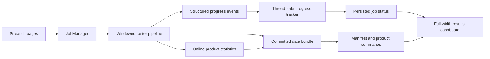
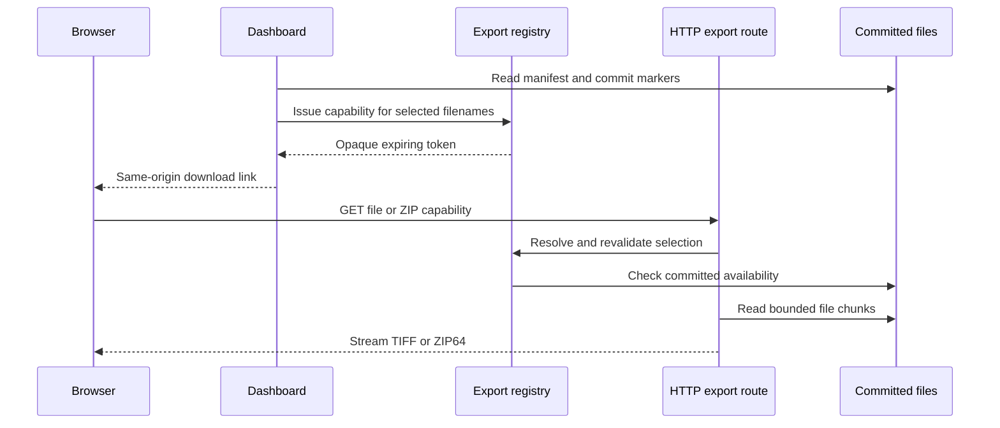

# Results and processing experience

Implemented on 2026-11-14. This iteration covers the first-priority results dashboard, output delivery, quality summaries and processing feedback. Setup presets, catalog date selection, richer AOI editing and a searchable job history remain possible later iterations.

## User workflow

Results occupy the full page width below the setup/map columns. Five metrics distinguish acquisition dates found, dates saved, dates skipped, committed raster count and output size. Catalog truncation and SCL filtering have separate disclosures: successful processing does not imply a complete catalog search or cloud-free imagery.

| View | Behavior |
|---|---|
| Preview | Select a raster/layer; display a masked thumbnail bounded to 640 pixels per side. RGB uses a fixed 0–0.30 reflectance stretch. Index previews use a fixed −1 to +1 legend and mark out-of-range values in magenta without modifying data. |
| Files | Filter by date/product, inspect resolution/size/coverage, download one TIFF or a filtered ZIP, and export statistics CSV. |
| Quality | Compare outcomes and valid AOI coverage; inspect per-band/product statistics and actionable skip reasons. Raw errors remain available in an expander. |
| Run details | Review requested settings, server output location, resource/grid details and the processing manifest. |

Progress reports resource waits, preparation, validation, raster-window work, finalization and date completion. The fraction measures image work; overviews and publication can still be running when image work reaches 100%. ETA is withheld until there is enough completed work and is suppressed for mixed skipped/resumed workloads. The UI polls active jobs every two seconds and stops polling terminal jobs. Cancellation remains cooperative.

Timeseries results use the full width, show accepted/rejected counts, provide CSV and diagnostic downloads, and preserve gaps for rejected acquisition dates in the chart. No daily observations are fabricated between acquisitions. Saved requests can be retried with unchanged settings while committed raster dates are reused.

## Quality semantics and bounded processing

Coverage is valid product pixels divided by rasterized AOI pixels, including polygon holes correctly. It is grid based, not geodesic area coverage. Composite validity and each index's validity are tracked separately; a valid composite pixel can have an invalid zero-denominator index. Coverage is distinct from catalog completeness, date completion and the percentage of a date with clear sky.

Count, minimum, maximum and mean use every valid pixel. Median, P10 and P90 use a reproducible uniform sample capped at 16,384 values per band/product; the UI and CSV disclose the sample size and approximation. Statistics are accumulated alongside existing window writes. Older committed results can be summarized by reading bounded windows without rewriting their TIFFs.

Calibration now performs scale/offset arithmetic with a float64 temporary before storing float32 reflectance. This avoids a small float32 residual for DN 1000 × 0.0001 − 0.1, which should be physical zero, and preserves zero-denominator rejection.

## Export architecture

`app.py` constructs `st.App` around `portal.py` and registers Starlette export routes. The usual `streamlit run app.py` command remains the entry point. Both routes and generated links respect `server.baseUrlPath`. Pillow and Starlette are now explicit dependencies; Streamlit's minimum version is 1.67.

Only files listed in a saved manifest row and matching date commit marker are exposed. The registry issues opaque one-hour capabilities and rechecks eligibility on requests; staging files, symlinks and paths outside the output directory are rejected. Links are private bearer capabilities under the existing local/trusted app model, not a new authentication system. Process restart invalidates links; refresh generates new links. The registry is bounded to 2,048 grants.

Individual TIFF delivery supports HEAD and byte ranges. ZIP64 bundles stream uncompressed TIFF entries in 64 KiB input chunks without building an archive in memory or on disk. ZIP metadata is bounded by the 1,000-file selection limit. Responses disable caching and gzip recompression. A disconnected client may need to restart a ZIP download; individual TIFF range requests support resuming. Running multiple server processes requires session affinity or a shared capability registry in a future deployment design.

## Verification and performance

The suite passes 113 offline unittest cases, including real temporary raster statistics/coverage, physical-zero calibration, preview masks, progress concurrency, legacy summary upgrades, Streamlit AppTest results rendering and ASGI streaming/range/expiry/path checks. Ruff, whitespace and locked-environment checks pass. A live local HTTP check through the Streamlit CLI verified prefixed `/uxcheck` health and a valid three-file ZIP (558,864 bytes), with gzip recompression disabled. See [validation evidence](ux_validation_results.json). Automated UI checks validate rendered elements and state; visual browser layout and map interactions have not been verified because a reliable browser-control surface was unavailable.

[Current benchmark evidence](ux_benchmark_results.json) compares the original pipeline and this implementation, including online summaries, on identical local synthetic rasters with eight bands and three indices. At 2048 × 2048, original processing took 4.010 seconds and 630.28 MiB peak RSS; current processing took 2.590 seconds and 199.50 MiB. This is approximately 35% less elapsed time and 68% less peak RSS. Measurements are single runs, exclude network/import/fixture time, use one worker and disable overviews. They establish local pipeline behavior, not cloud throughput or UI server memory. Float32 reflectance output occupies more disk space than the original integer-valued DN output in this fixture.

The historical architecture benchmark is preserved separately; its source hashes describe that earlier revision. The new benchmark includes `result_metrics.py` in its source hash inventory.
